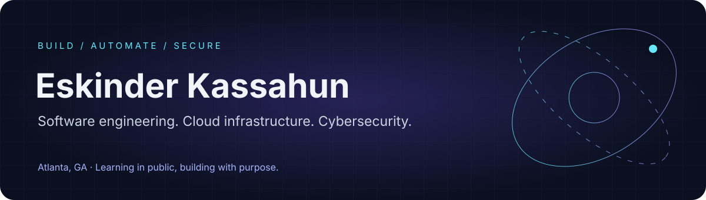
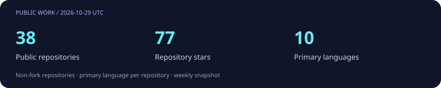

  

  <a href="https://eskinder.dev">Explore my portfolio ↗</a> ·
  <a href="https://www.linkedin.com/in/eskinder-kassahun/">LinkedIn</a> ·
  <a href="mailto:eskinderkassahun25@gmail.com">Email</a>

## Building across the stack

I’m **Eskinder Kassahun**, a cloud and security-minded software engineer in
Atlanta, Georgia. I build web applications, explore AWS infrastructure and learn
how to make systems easier to operate and secure.

My foundation includes a B.S. in Computer Science, AWS re/Start training and
full-stack development training. My repositories bring that learning into
practice through React applications, infrastructure labs and security-focused
experiments.

**Currently exploring:** software delivery, cloud automation, cybersecurity and
AI-assisted tools.

## Engineering toolkit

| Discipline | Tools and areas of practice |
| --- | --- |
| Cloud | AWS · IAM · VPC · EC2 · serverless architecture |
| DevOps | GitHub Actions · Git · Linux · Bash · Terraform |
| Cybersecurity | Identity and access · Web Crypto · security monitoring |
| AI | Python · reinforcement-learning experiments · Bedrock integrations |
| Frontend | React · TypeScript · HTML · CSS · Tailwind CSS |
| Backend | Node.js · Express · Python · Java |
| Databases | Firestore · MongoDB · PostgreSQL |

## Selected projects

### [CodeRush](https://github.com/Eskinder185/CodeRush)

Developer typing practice with language lessons, active-session timing and
progress statistics. Built with **React, TypeScript and Vite**.
[Open public frontend ↗](https://eskinder185.github.io/CodeRush/)

### [Hive](https://github.com/Eskinder185/Hive)

Community chat with **React and Firebase**, live Firestore subscriptions and
client-side message encryption. Authenticated functionality and encryption
security have not been independently audited.
[Open public frontend ↗](https://eskinder185.github.io/Hive/)

### [JohnnyCloud](https://github.com/Eskinder185/JohnnyCloud)

An AWS FinOps and SecOps dashboard with a **React** frontend and source for
infrastructure and Lambda integrations. Documentation covers cost trends,
security findings, identity and AI assistance. **Live AWS deployment unverified;
Pages demo unavailable.**

### [QuizForge](https://github.com/Eskinder185/QuizForge)

A quiz workspace with authoring, study, exam, library and result routes, built
with **React, TypeScript and Vite**.
[Open public frontend ↗](https://eskinder185.github.io/QuizForge/)

### [Cloud Launchpad](https://github.com/Eskinder185/cloud-launchpad-vpc-ec2)

A focused **CloudFormation** learning project defining a VPC, private subnet,
security group and EC2 instance. Source and deployment instructions are available.

### [Hybrid Cloud Security Lab](https://github.com/Eskinder185/Hybrid-Cloud-Security-Lab)

Architecture documentation for a **Proxmox, Linux and pfSense** lab, exploring
network segmentation, storage and monitoring. The repository currently provides
an overview and architecture image; operational results are not independently
verified.

**More work:** [AstraFocusNexus](https://github.com/Eskinder185/AstraFocusNexus) ·
[ZeroEffort Tracker](https://github.com/Eskinder185/ProgreesTracker) ·
[AlignID](https://github.com/Eskinder185/AlignID) ·
[All repositories](https://github.com/Eskinder185?tab=repositories)

Frontend links checked October 29, 2026. A reachable frontend does not certify
an authenticated service or every application feature.

## A snapshot of the work

This is a dated snapshot of public work, not a live counter or a skill rating.
[Explore activity on GitHub](https://github.com/Eskinder185?tab=overview) or
[read how the visuals are maintained](docs/MAINTENANCE.md).

  
Play the contribution snake — refreshed weekly

  
The animation below follows my public GitHub contribution grid.

  

## Let’s build something useful

I’m interested in cloud infrastructure, security and thoughtful software.
If your project connects those worlds, I’d enjoy comparing notes.

[Start a conversation](mailto:eskinderkassahun25@gmail.com) ·
[Explore the interactive portfolio](https://eskinder.dev)
